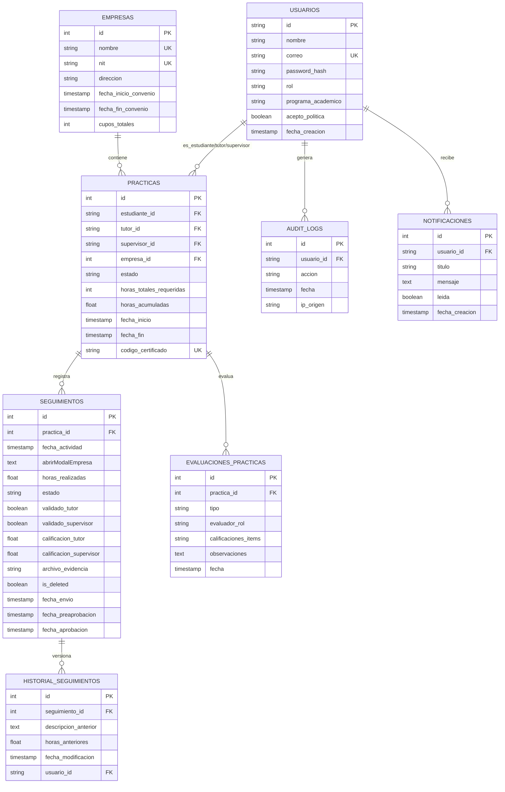

# Manual Técnico de Arquitectura e Integración - SIPGA v1.0
## Sistema de Información para Gestión de Prácticas Académicas

Este documento detalla la arquitectura técnica, modelo de datos relacional, flujos de integración, y mecanismos de seguridad del backend de **SIPGA**, diseñado para desarrolladores y administradores de sistemas.

---

## 🛠️ 1. Arquitectura General
El sistema utiliza una arquitectura desacoplada de dos capas:
1.  **Frontend (Presentación):** HTML5, CSS3 (Vanilla + Tailwind para estructuración responsive) y JavaScript ES6 modular. Se comunica con el backend mediante peticiones asíncronas (`fetch`) seguras.
2.  **Backend (Lógica de Negocio y API):** Desarrollado sobre **FastAPI** (Python 3.9+). Proporciona un servicio RESTful documentado automáticamente mediante Swagger/OpenAPI.
3.  **Base de Datos (Persistencia):** PostgreSQL en la nube (**Neon PostgreSQL**) gestionado mediante el ORM **SQLAlchemy**.

---

## 🗄️ 2. Modelo de Datos Relacional (PostgreSQL)

El esquema de base de datos consta de las siguientes tablas principales y relaciones:



---

## 🔌 3. Endpoints Clave y Reglas de Negocio

### 🔑 3.1. Autenticación y Autorización
*   **Ruta:** `POST /api/v1/auth/token`
    *   **Cuerpo:** Formulario estándar OAuth2 (`username` y `password`).
    *   **Procesamiento:** Validación mediante hash bcrypt. Devuelve un JWT (`access_token`) con expiración de 120 minutos. El token debe ser enviado en la cabecera `Authorization: Bearer <token>` para todas las peticiones restringidas.

### 📊 3.2. Límites y Reglas de Reportes (Seguimientos)
*   **Crear Seguimiento:** `POST /api/v1/seguimientos/`
*   **Regla de Negocio (Límite Horario):** Valida antes de guardar que:
    1.  Las horas realizadas no superen **8 horas** en una misma fecha.
    2.  La suma de horas en la misma semana (rango de 7 días anteriores) no sea mayor a **48 horas**.
    3.  El estado inicial sea `borrador` o `enviado`.
*   **Historial de Versiones:** Si el seguimiento está en estado `rechazado`, al ser modificado por el estudiante a través de `PUT /api/v1/seguimientos/{id}`, se inserta automáticamente un registro en `historial_seguimientos` conservando la versión previa para auditoría pedagógica.

### 🏛️ 3.3. Convenios y Gestión del Coordinador
*   **Crear Práctica:** `POST /api/v1/practicas/`
    *   **Regla de Negocio (Convenios):** Valida que la fecha actual o de inicio de la práctica se encuentre dentro de las fechas `fecha_inicio_convenio` y `fecha_fin_convenio` registradas en la tabla `Empresa`. Si el convenio está vencido, arroja una excepción `400 Bad Request`.
*   **Carga Masiva (CSV):** `POST /api/v1/coordinador/cargar-usuarios-csv`
    *   **Formato de entrada:** Archivo CSV delimitado por comas con las columnas: `nombre`, `correo`, `rol`, `programa_academico` (opcional).
*   **Torre de Control de Alertas Críticas (Novedad):** `GET /api/v1/coordinador/alertas-criticas`
    *   Genera un reporte consolidado agrupando:
        1.  *Retrasos:* Proyección lineal de progreso negativo según fechas.
        2.  *Inactividad:* Estudiantes sin reportes válidos por más de 7 días.
        3.  *Convenios:* Alertas de empresas con convenios vencidos o próximos a expirar (<= 60 días).
        4.  *Cuellos de Botella:* Tareas de revisión docente o supervisoras demoradas por más de 5 días.
*   **Exportación Consolidada CSV (Novedad):** `GET /api/v1/coordinador/exportar-practicas-csv`
    *   Genera dinámicamente un archivo de texto plano delimitado por punto y coma (`;`).
    *   Incluye un encabezado de 3 bytes (BOM UTF-8: `\ufeff`) para garantizar que Microsoft Excel en español detecte la codificación de caracteres acentuados sin corrupción.

### 📑 3.4. Certificaciones y Verificación Pública
*   **Descargar Reporte PDF:** `GET /api/v1/practicas/{id}/reporte-pdf`
    *   **Tecnología:** ReportLab. Genera en caliente el consolidado.
    *   **Generación de QR Vectorial:** Dibuja directamente sobre el lienzo del PDF (`Drawing` y `QrCodeWidget` de `reportlab.graphics.barcode.qr`) un código QR que contiene la URL absoluta de verificación del certificado (ej. `http://localhost:5500/frontend/verificar.html?codigo=<codigo_certificado>`).
    *   **Firmas:** Agrega un bloque estructurado para 3 firmas (Coordinador de Programa, Supervisor de la Empresa y Tutor Académico).
*   **Verificar Certificado (Público):** `GET /api/v1/practicas/verificar/{codigo}`
    *   **Acceso:** Público (no requiere cabeceras de autorización). Devuelve los metadatos de validación correspondientes para renderizar en `verificar.html`.

---

## 📧 4. Servicio de Notificaciones SMTP Asíncronas
*   **Ubicación:** `backend/email_service.py`
*   **Funcionamiento:** Cuando un estudiante envía un informe o un tutor/supervisor emite una calificación/validación, se invoca el servicio de correo.
*   **Asincronía:** Se utiliza la clase `BackgroundTasks` de FastAPI. Esto evita retrasar la respuesta HTTP del cliente al delegar la conexión SMTP y el envío del correo a un hilo de ejecución en segundo plano.
*   **Configuración:** Requiere configurar variables SMTP en el archivo `.env` (`SMTP_HOST`, `SMTP_PORT`, `SMTP_USER`, `SMTP_PASSWORD`). Si no están configuradas, el sistema escribe el contenido del correo de forma local en los logs de auditoría para fines de desarrollo.

---

## 🚀 5. Despliegue y Migraciones
1.  **Ejecutar Migraciones:**
    Para sincronizar nuevas columnas o tablas sobre una base de datos PostgreSQL en caliente:
    ```powershell
    python backend/apply_migrations.py
    ```
    Este script ejecuta sentencias DDL puras con la cláusula `IF NOT EXISTS` para evitar pérdida de datos existentes.
2.  **Poblar Base de Datos (Seeding):**
    Para crear datos reales de prueba (coordinadores, tutores, empresas, prácticas activas, registros de horas y seguimientos):
    ```powershell
    python backend/seed_data.py
    ```
3.  **Pruebas del Sistema:**
    La suite de pruebas automatizadas está basada en `pytest`. Para correr los tests unitarios y de integración:
    ```powershell
    python -m pytest
    ```